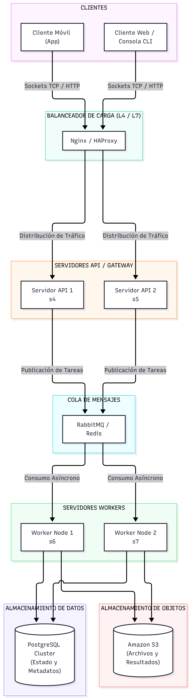

# Práctica Formativa Obligatoria 3 (PFO 3)
## Rediseño como Sistema Distribuido (Cliente-Servidor)

**Materia:** Programación sobre Redes  
**Profesor:** Alan Portillo  
**Entregable:** Arquitectura de Sistema Distribuido (Sockets + Pool de Workers) y Diagrama de Componentes

---

## 📋 Descripción del Proyecto

El objetivo de esta práctica es transformar el sistema en una **arquitectura distribuida** utilizando comunicación mediante **sockets TCP** en Python, desacoplando la recepción de solicitudes del procesamiento pesado mediante un **pool de workers** y colas de tareas.

El proyecto se compone de:
1. **Servidor Distribuido (`servidor.py`)**: Acepta conexiones entrantes por sockets, recibe solicitudes JSON y distribuye la carga a un `ThreadPoolExecutor` de workers concurrentes.
2. **Cliente Interactivo (`cliente.py`)**: Interfaz CLI que envía tareas por socket (procesamiento de texto, operaciones matemáticas, etc.) y consulta de manera asíncrona o directa los resultados.
3. **Diseño de Arquitectura Distribuida**: Diagrama conceptual y especificación técnica de los componentes a escala de producción.

---

## 🏗️ 1. Diagrama de la Arquitectura Distribuida



Figura 1: Flujo de datos desde los clientes hasta el almacenamiento distribuido, pasando por el balanceador de carga, los gateways TCP, la cola de mensajes y el pool de workers.
---

## 🧩 Explicación de los Componentes del Diagrama

1. **Clientes (Móviles, Web, CLI):**
   * Puntos de origen que interactúan con la plataforma mediante sockets TCP o peticiones HTTP enviando solicitudes codificadas en JSON.
2. **Balanceador de Carga (Nginx / HAProxy):**
   * Distribuye el tráfico entrante de manera equitativa entre múltiples instancias de servidores de API (vía algoritmos como *Round-Robin* o *Least Connections*), garantizando alta disponibilidad y tolerancia a fallos.
3. **Servidores API / Sockets Gateway (`servidor.py`):**
   * Reciben las conexiones de los clientes, autentican la solicitud y colocan la tarea en la cola de procesamiento sin bloquear al cliente.
4. **Cola de Mensajes (RabbitMQ):**
   * Garantiza el **desacoplamiento** entre la recepción y el procesamiento. Asegura la persistencia de mensajes y permite absorber picos de tráfico (*rate-leveling*).
5. **Servidores Workers (`ThreadPoolExecutor`):**
   * Nodos de cómputo dedicados que consumen tareas de la cola de RabbitMQ. Cada worker utiliza un pool de hilos (`ThreadPoolExecutor`) para ejecutar múltiples tareas concurrentemente aprovechando los recursos multinúcleo.
6. **Almacenamiento Distribuido (PostgreSQL + S3):**
   * **PostgreSQL:** Base de datos relacional replicada donde se registra el estado de las tareas (`EN_PROGRESO`, `COMPLETADO`, `ERROR`) y la información de usuarios.
   * **Amazon S3 / MinIO:** Almacenamiento de objetos utilizado para guardar archivos pesados y reportes generados por los workers.

---

## 🚀 Guía de Ejecución y Pruebas Locales

### Requisitos
- **Python 3.8+** (utiliza únicamente la librería estándar de Python: `socket`, `threading`, `json`, `concurrent.futures`).

### Paso 1: Iniciar el Servidor Distribuido
En una terminal ejecute:
```bash
python servidor.py
```
*El servidor creará el pool de workers y quedará escuchando conexiones por socket en `localhost:5000`.*

### Paso 2: Iniciar el Cliente en Consola
En otra terminal ejecute:
```bash
python cliente.py
```

### Opciones del Menú:
1. **Enviar nueva tarea:** Permite seleccionar el tipo de tarea (procesar texto a mayúsculas, cálculo matemático o tarea genérica). El servidor responde de inmediato con el `ID` de tarea.
2. **Consultar resultado de tarea por ID:** Consulta el estado actual en la base de datos distribuida (`EN_PROGRESO` o `COMPLETADO` con su resultado).
3. **Listar todas las tareas:** Muestra un resumen general de todas las tareas procesadas por los workers.

---

## 📁 Estructura del Entregable (`pfo3_redes.zip`)

```text
pfo3_redes.zip
├── servidor.py          # Servidor TCP Socket + ThreadPoolExecutor Workers
├── cliente.py           # Cliente interactivo en consola mediante Sockets
└── README.md            # Documentación técnica, diagrama y guía de pruebas
```


---

## 🐙 4. Configuración para Subir a GitHub (sin BD ni temporales)

Para publicar el código en GitHub siguiendo las mejores prácticas, se incluye un archivo  en la raíz del repositorio.

### Pasos sugeridos:
1. Inicializar el repositorio local: Initialized empty Git repository in /workspace/.git/
2. Agregar los archivos al área de preparación: 
3. Realizar el primer commit: 
4. Renombrar la rama principal: 
5. Vincular y subir al repositorio remoto de GitHub.
